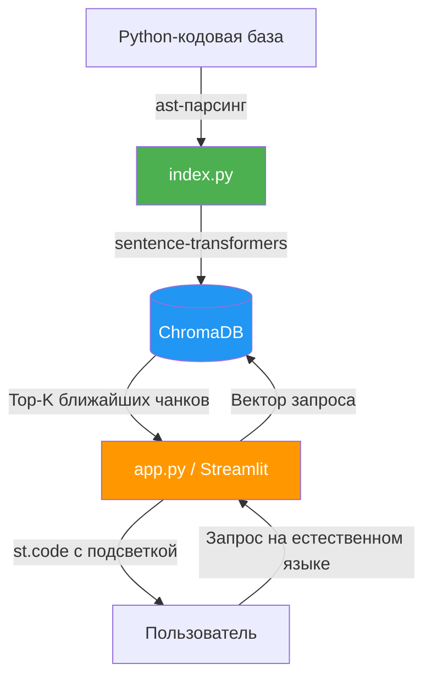
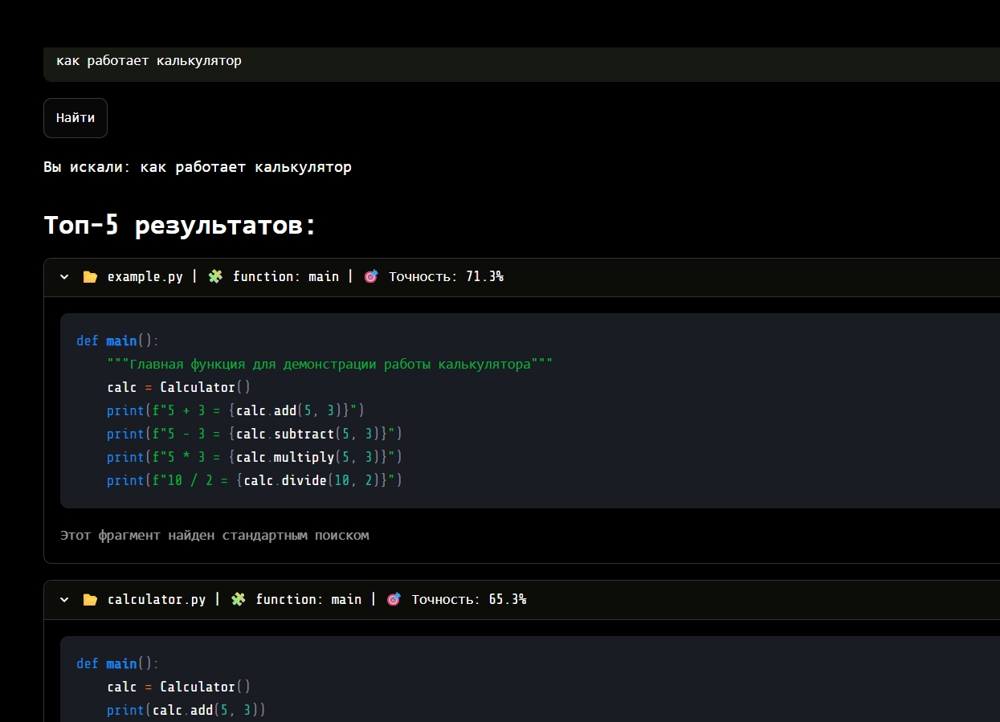
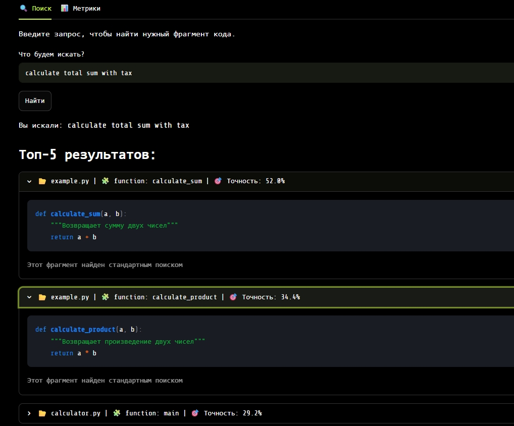
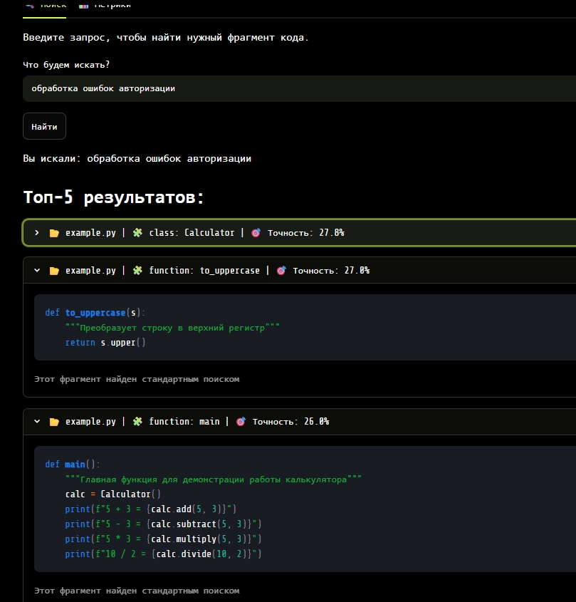
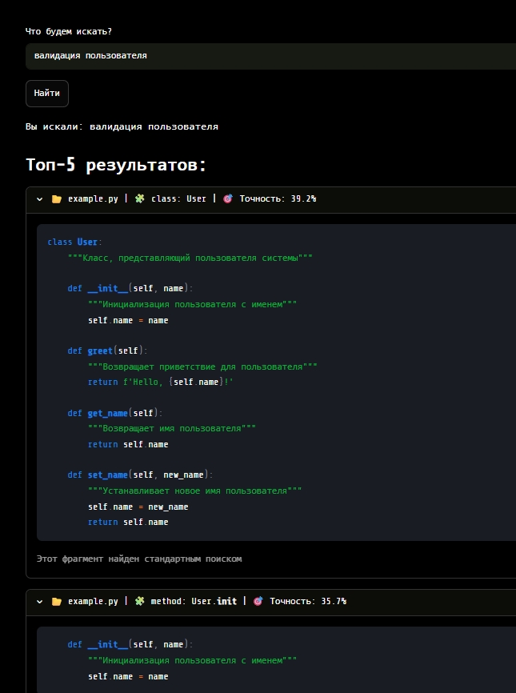
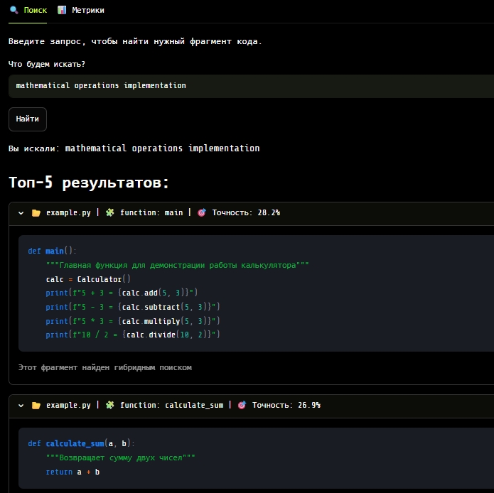

# CodeLens — Умный поиск по кодовой базе (RAG-система)

Прототип RAG-системы для семантического поиска по Python-коду. Система понимает вопросы на естественном языке (русский и английский) и находит релевантные фрагменты кода, даже если слова запроса не совпадают с именами функций и переменных.

## Архитектура системы

Система состоит из трёх компонентов, все на Python:



| Компонент | Файл | Назначение |
|---|---|---|
| Индексатор | `index.py` → `indexer/indexer.py` | AST-парсинг `.py`-файлов, генерация эмбеддингов, запись в ChromaDB |
| Поисковый движок | `search_engine.py` | Векторный и гибридный (вектор + TF-IDF) поиск, расчёт метрик |
| Веб-интерфейс | `app.py` | Streamlit: поле ввода, карточки результатов, страница метрик |

## Запуск

### Локально

Требования: Python 3.12

```bash
# 1. Клонируйте репозиторий
git clone https://github.com/CaseyDunne/codelens-rag-system.git
cd codelens-rag-system

# 2. Создайте виртуальное окружение
python -m venv venv
source venv/bin/activate        # Linux/Mac
venv\Scripts\activate           # Windows

# 3. Установите зависимости
pip install -r requirements.txt

# 4. Проиндексируйте кодовую базу (база каждый раз пересоздаётся с нуля)
python index.py indexer/gymhero/gymhero

# 5. Запустите веб-интерфейс
streamlit run app.py
```

Откройте в браузере: http://localhost:8501

Чтобы добавить ещё один проект к уже существующей базе: `python index.py <папка> --append`.

### Через Docker

```bash
docker compose up
```

При первом запуске контейнер индексирует папку из переменной `INDEX_DIR` (по умолчанию — датасет gymhero) и запускает UI. Повторные запуски используют сохранённую базу. Чтобы переиндексировать, удалите папку `chroma_db`.

## Стратегия чанкования

**Один чанк = одна функция, класс или метод.**

- Функция — минимальная законченная смысловая единица Python-кода: у неё есть вход, действие и результат. Целый файл даёт слишком много лишнего, фиксированное число строк разрывает логику посередине.
- Модуль `ast` даёт точные границы каждой функции и класса (включая декораторы), поэтому фрагменты не обрезаются.
- Вопросы пользователей обычно касаются конкретного действия («где проверяется пароль»), а это и есть функция или метод.
- Каждый метод сохраняется один раз (с именем вида `Класс.метод`); функции, вложенные в другие функции, остаются частью внешней функции.

**Что идёт в эмбеддинг.** Кроме кода в текст для эмбеддинга добавляются тип, имя, путь к файлу и docstring. Составные имена дополнительно пишутся через пробелы (`get_current_user` → `get current user`), чтобы модель сопоставляла их с обычными словами вопроса. Эти поля ставятся в начало текста, потому что модель читает ограниченное число токенов и конец длинной функции отбрасывает.

Формат ID чанка: `<путь_к_файлу>:<имя>:<номер строки def/class>`, например `api/dependencies.py:get_current_user:58`.

## Обоснование выбора технологий

| Решение | Почему |
|---|---|
| Модель `paraphrase-multilingual-MiniLM-L12-v2` | Понимает русский и английский в одном векторном пространстве, компактная (384 измерения), работает на CPU |
| ChromaDB | Встроенная векторная БД: эмбеддинги и метаданные в одном месте, не нужен отдельный сервер. Для нескольких сотен чанков разница в скорости с FAISS незаметна |
| AST-парсинг | Точный синтаксический разбор: границы функций и классов, docstring — то, что теряется при нарезке регулярными выражениями |
| Streamlit | UI на Python без JavaScript, подсветка кода одной строкой `st.code(..., language="python")` |
| Гибридный поиск | `alpha × косинусная близость + (1 − alpha) × TF-IDF`. TF-IDF помогает, когда в запросе есть точные имена из кода; вес `alpha` настраивается в интерфейсе |

## Метрики качества

Метрики считаются командой:

```bash
python search_engine.py --eval eval_questions_gymhero.json            # векторный поиск
python search_engine.py --eval eval_questions_gymhero.json --hybrid   # гибридный
python search_engine.py --eval eval_questions_gymhero.json --compare  # таблица сравнения режимов
```

Результат сохраняется в `metrics.json` и показывается на вкладке «Метрики» в интерфейсе (там же есть разбивка по вопросам).

| Метрика | Что означает |
|---|---|
| **Precision@5** | Доля правильных фрагментов среди 5 выданных. Если у вопроса один эталонный фрагмент, максимум — 20% |
| **Hit Rate@5** | Доля вопросов, где хотя бы один правильный фрагмент попал в топ-5 |
| **Recall@5** | Доля эталонных фрагментов вопроса, попавших в топ-5 |
| **MRR** | Насколько высоко стоит первый правильный ответ (1 — всегда на первом месте) |
| **Latency** | Время ответа на каждый запрос: среднее, p95, максимум |

Результаты на датасете gymhero (35 файлов с кодом, 155 чанков, 20 вопросов — 10 на русском, 10 на английском):

| Режим | Precision@5 | Hit Rate@5 | MRR | Hit Rate@5 (ru) | Hit Rate@5 (en) | Среднее время |
|---|---|---|---|---|---|---|
| Векторный | _заполнить после прогона_ | | | | | |
| Гибридный, alpha=0.6 | | | | | | |

Тестовые наборы:
- `eval_questions_gymhero.json` — 20 вопросов по датасету gymhero (FastAPI-сервис);
- `eval_questions.json` — 15 простых вопросов по папке `test_code` (для быстрой проверки).

## Примеры запросов

### Пример 1: поиск на русском языке
Запрос: «Как здесь обрабатываются ошибки авторизации?»



### Пример 2: поиск на английском языке
Запрос: «calculate total sum with tax»



### Пример 3: семантический поиск
Запрос: «Обработка ошибок авторизации»



### Пример 4: поиск по классу или сложной логике
Запрос: «валидация пользователя»



### Пример 5: поиск на английском языке
Запрос: «mathematical operations implementation»



## Роли в команде

| Роль | Зона ответственности |
|---|---|
| Инженер по индексации | AST-парсинг, чанкование, генерация эмбеддингов, запись в ChromaDB |
| Бэкенд-разработчик | Векторный и гибридный поиск, расчёт метрик |
| UI-инженер | Streamlit-приложение: карточки результатов, подсветка, страница метрик |
| Интегратор | Точка входа `index.py`, `requirements.txt`, Docker Compose, документация |

## Известные ограничения

- Поддерживается только Python-код (через `ast`).
- Генерация связных ответов через LLM не реализована.
- Модель эмбеддингов скачивается при первом запуске (~470 МБ) и кэшируется в `~/.cache/huggingface/`.
- Модель читает ограниченное число токенов, поэтому у очень длинных функций в эмбеддинг попадает только начало.
