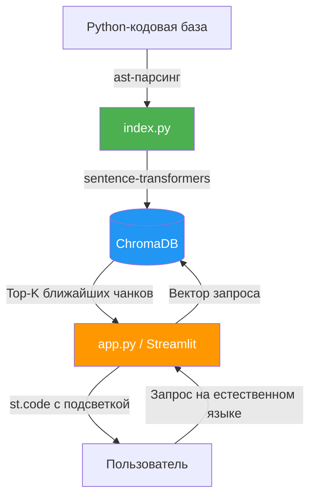
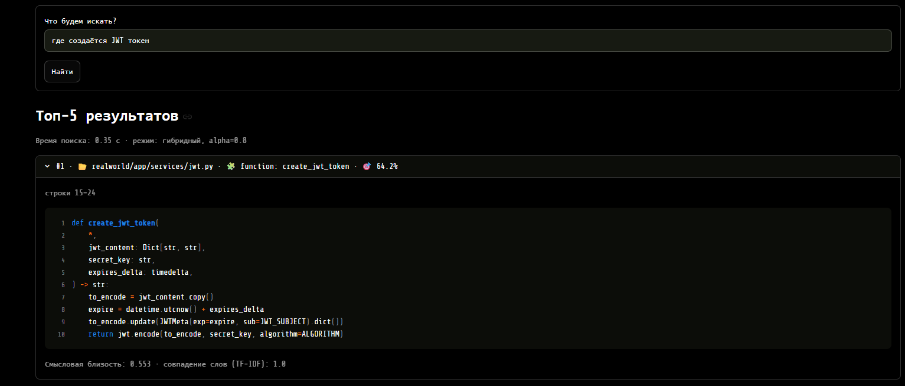
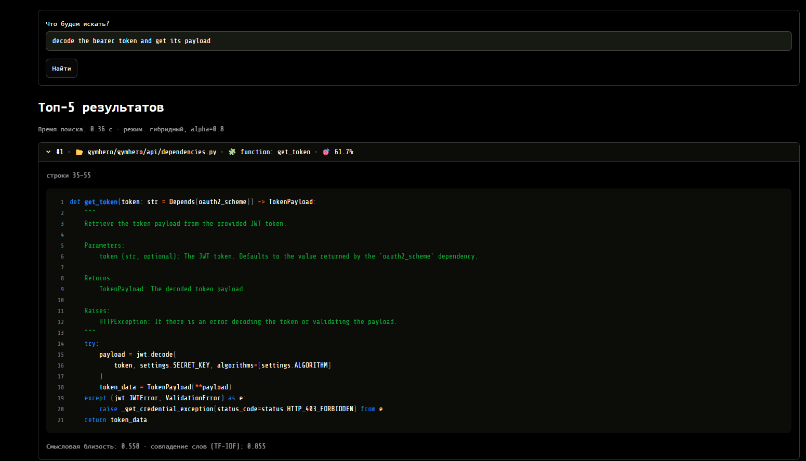
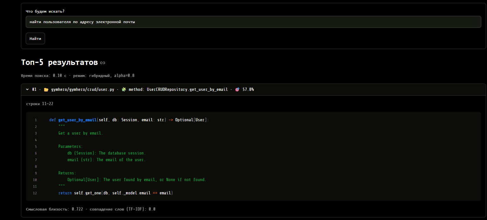
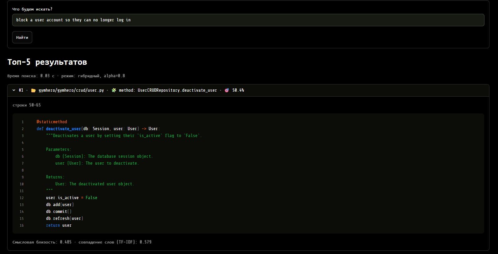
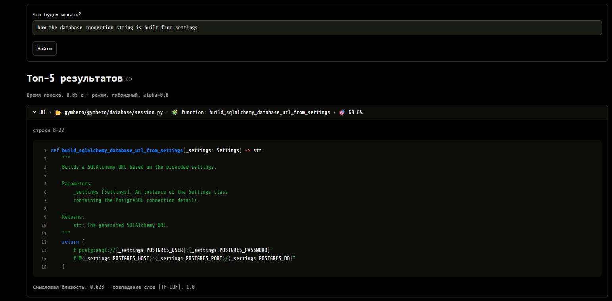

# CodeLens — Умный поиск по кодовой базе (RAG-система)

Прототип RAG-системы для семантического поиска по Python-коду. Система понимает вопросы на естественном языке (русский и английский) и находит релевантные фрагменты кода, даже если слова запроса не совпадают с именами функций и переменных.

## Архитектура системы

Система состоит из трёх компонентов, все на Python:



| Компонент | Файл | Назначение |
|---|---|---|
| Индексатор | `index.py` → `indexer/indexer.py` | AST-парсинг `.py`-файлов, генерация эмбеддингов, запись в ChromaDB |
| Поисковый движок | `search_engine.py` | Векторный и гибридный (вектор + TF-IDF) поиск, расчёт метрик |
| Веб-интерфейс | `app.py` | Streamlit: поле ввода, карточки результатов, страница метрик |

## Запуск

### Локально

Требования: Python 3.12

```bash
# 1. Клонируйте репозиторий
git clone https://github.com/CaseyDunne/codelens-rag-system.git
cd codelens-rag-system

# 2. Создайте виртуальное окружение
python -m venv venv
source venv/bin/activate        # Linux/Mac
venv\Scripts\activate           # Windows

# 3. Установите зависимости
pip install -r requirements.txt

# 4. Проиндексируйте кодовую базу (база каждый раз пересоздаётся с нуля)
python index.py dataset

# 5. Запустите веб-интерфейс
streamlit run app.py
```

Откройте в браузере: http://localhost:8501

Чтобы добавить ещё один проект к уже существующей базе: `python index.py <папка> --append`.

### Через Docker

```bash
docker compose up
```

При первом запуске контейнер индексирует папку из переменной `INDEX_DIR` (по умолчанию — `dataset`) и запускает UI. Повторные запуски используют сохранённую базу. Чтобы переиндексировать, удалите папку `chroma_db`.

## Датасет

Папка `dataset/` — два открытых FastAPI-проекта (лицензия MIT), всего 119 `.py`-файлов:

| Проект | Что это | Файлов |
|---|---|---|
| `dataset/gymhero` | [gymhero](https://github.com/JakubPluta/gymhero) — API для планирования тренировок | 47 |
| `dataset/realworld` | [fastapi-realworld-example-app](https://github.com/nsidnev/fastapi-realworld-example-app), папка `app/` — бэкенд блог-платформы (статьи, комментарии, подписки) | 72 |

Два проекта с похожими задачами (пользователи, JWT, пароли, работа с БД), но разной архитектурой — так проверяется, что поиск находит нужный код, а не просто «любой код про авторизацию».

## Стратегия чанкования

**Один чанк = одна функция, класс или метод.**

- Функция — минимальная законченная смысловая единица Python-кода: у неё есть вход, действие и результат. Целый файл даёт слишком много лишнего, фиксированное число строк разрывает логику посередине.
- Модуль `ast` даёт точные границы каждой функции и класса (включая декораторы), поэтому фрагменты не обрезаются.
- Вопросы пользователей обычно касаются конкретного действия («где проверяется пароль»), а это и есть функция или метод.
- Каждый метод сохраняется один раз (с именем вида `Класс.метод`); функции, вложенные в другие функции, остаются частью внешней функции.

**Что идёт в эмбеддинг.** Кроме кода в текст для эмбеддинга добавляются тип, имя, путь к файлу и docstring. Составные имена дополнительно пишутся через пробелы (`get_current_user` → `get current user`), чтобы модель сопоставляла их с обычными словами вопроса. Эти поля ставятся в начало текста, потому что модель читает ограниченное число токенов и конец длинной функции отбрасывает.

Формат ID чанка: `<путь_к_файлу>:<имя>:<номер строки def/class>`, например `api/dependencies.py:get_current_user:58`.

## Обоснование выбора технологий

| Решение | Почему |
|---|---|
| Модель `paraphrase-multilingual-MiniLM-L12-v2` | Понимает русский и английский в одном векторном пространстве, компактная (384 измерения), работает на CPU |
| ChromaDB | Встроенная векторная БД: эмбеддинги и метаданные в одном месте, не нужен отдельный сервер. Для нескольких сотен чанков разница в скорости с FAISS незаметна |
| AST-парсинг | Точный синтаксический разбор: границы функций и классов, docstring — то, что теряется при нарезке регулярными выражениями |
| Streamlit | UI на Python без JavaScript, подсветка кода одной строкой `st.code(..., language="python")` |
| Гибридный поиск | `alpha × косинусная близость + (1 − alpha) × TF-IDF`. TF-IDF помогает, когда в запросе есть точные имена из кода; вес `alpha` настраивается в интерфейсе |

## Метрики качества

Метрики считаются командой:

```bash
python search_engine.py            # векторный поиск
python search_engine.py --hybrid   # гибридный
python search_engine.py --compare  # таблица сравнения режимов
```

Результат сохраняется в `metrics.json` и показывается на вкладке «Метрики» в интерфейсе (там же есть разбивка по вопросам).

| Метрика | Что означает |
|---|---|
| **Precision@5** | Доля правильных фрагментов среди 5 выданных. Если у вопроса один эталонный фрагмент, максимум — 20% |
| **Hit Rate@5** | Доля вопросов, где хотя бы один правильный фрагмент попал в топ-5 |
| **Recall@5** | Доля эталонных фрагментов вопроса, попавших в топ-5 |
| **MRR** | Насколько высоко стоит первый правильный ответ (1 — всегда на первом месте) |
| **Latency** | Время ответа на каждый запрос: среднее, p95, максимум |

Результаты на датасете `dataset` (119 файлов, 320 чанков, 32 вопроса — 16 на русском, 16 на английском):

| Режим | Precision@5 | Hit Rate@5 | Recall@5 | MRR | Hit Rate@5 (ru) | Hit Rate@5 (en) | Среднее время |
|---|---|---|---|---|---|---|---|
| Векторный | 24,4% | 78,1% | 51,8% | 0,693 | 75,0% | 81,2% | 0,023 с |
| Гибридный, alpha=0.9 | 25,0% | 81,2% | 54,1% | 0,690 | 75,0% | 87,5% | 0,024 с |
| **Гибридный, alpha=0.8** | **26,9%** | **87,5%** | **59,3%** | **0,753** | 75,0% | **100%** | 0,021 с |
| Гибридный, alpha=0.7 | 26,9% | 87,5% | 59,3% | 0,742 | 75,0% | 100% | 0,024 с |
| Гибридный, alpha=0.6 | 26,9% | 87,5% | 59,3% | 0,725 | 75,0% | 100% | 0,024 с |
| Гибридный, alpha=0.5 | 26,2% | 84,4% | 58,3% | 0,719 | 75,0% | 93,8% | 0,023 с |

По умолчанию в интерфейсе стоит alpha = 0.8 — лучший MRR при максимальном Hit Rate.

Precision@5 ограничен сверху: в среднем у вопроса 2,5 эталонных фрагмента, а выдаётся всегда 5, поэтому даже идеальная система получила бы ~50,6%.

Тестовые наборы:
- `eval_questions.json` — 32 вопроса по датасету `dataset`. Набор составлен командой: к каждому вопросу вручную подобраны все подходящие фрагменты кода в обоих проектах;
- `eval_questions_test_code.json` — 15 простых вопросов по папке `test_code` (для быстрой проверки: `python index.py test_code`, затем `python search_engine.py --eval eval_questions_test_code.json`).

## Примеры запросов

Все примеры — в режиме по умолчанию (гибридный поиск, alpha = 0.8). Под каждым результатом интерфейс показывает две оценки: смысловую близость (нейросеть) и совпадение слов (TF-IDF).

### Пример 1: запрос на русском языке
Запрос: «где создаётся JWT токен»

Результат: на 1-м месте функция `create_jwt_token` из `realworld/app/services/jwt.py`. Она собирает данные пользователя, добавляет срок действия и подписывает токен секретным ключом. Запрос на русском, а код на английском — система нашла нужную функцию во втором проекте датасета.



### Пример 2: запрос на английском языке
Запрос: «decode the bearer token and get its payload»

Результат: на 1-м месте функция `get_token` из `gymhero/api/dependencies.py`. Она расшифровывает JWT-токен и возвращает его содержимое, а если токен неверный — возвращает ошибку доступа 403.



### Пример 3: поиск только по смыслу
Запрос: «найти пользователя по адресу электронной почты»

Результат: на 1-м месте метод `UserCRUDRepository.get_user_by_email` из `gymhero/crud/user.py`, который ищет пользователя в базе данных по email. Совпадение слов (TF-IDF) здесь равно 0 — ни одно слово запроса не встречается в коде. Функцию нашла только нейросеть, по смыслу.



### Пример 4: разные слова, один смысл
Запрос: «block a user account so they can no longer log in»

Результат: на 1-м месте метод `UserCRUDRepository.deactivate_user` из `gymhero/crud/user.py`. Он отключает пользователя, устанавливая флаг `is_active = False`. В коде нет слов «block» и «log in» — система поняла, что «заблокировать» и «деактивировать» означают одно и то же.



### Пример 5: точный технический запрос
Запрос: «how the database connection string is built from settings»

Результат: на 1-м месте функция `build_sqlalchemy_database_url_from_settings` из `gymhero/database/session.py`. Она собирает строку подключения к PostgreSQL из настроек: пользователь, пароль, адрес, порт и имя базы.



## Роли в команде

| Роль | Зона ответственности |
|---|---|
| Инженер по индексации | AST-парсинг, чанкование, генерация эмбеддингов, запись в ChromaDB |
| Бэкенд-разработчик | Векторный и гибридный поиск, расчёт метрик |
| UI-инженер | Streamlit-приложение: карточки результатов, подсветка, страница метрик |
| Интегратор | Точка входа `index.py`, `requirements.txt`, Docker Compose, документация |

## Известные ограничения

- Поддерживается только Python-код (через `ast`).
- Генерация связных ответов через LLM не реализована.
- Модель эмбеддингов скачивается при первом запуске (~470 МБ) и кэшируется в `~/.cache/huggingface/`.
- Модель читает ограниченное число токенов, поэтому у очень длинных функций в эмбеддинг попадает только начало.
